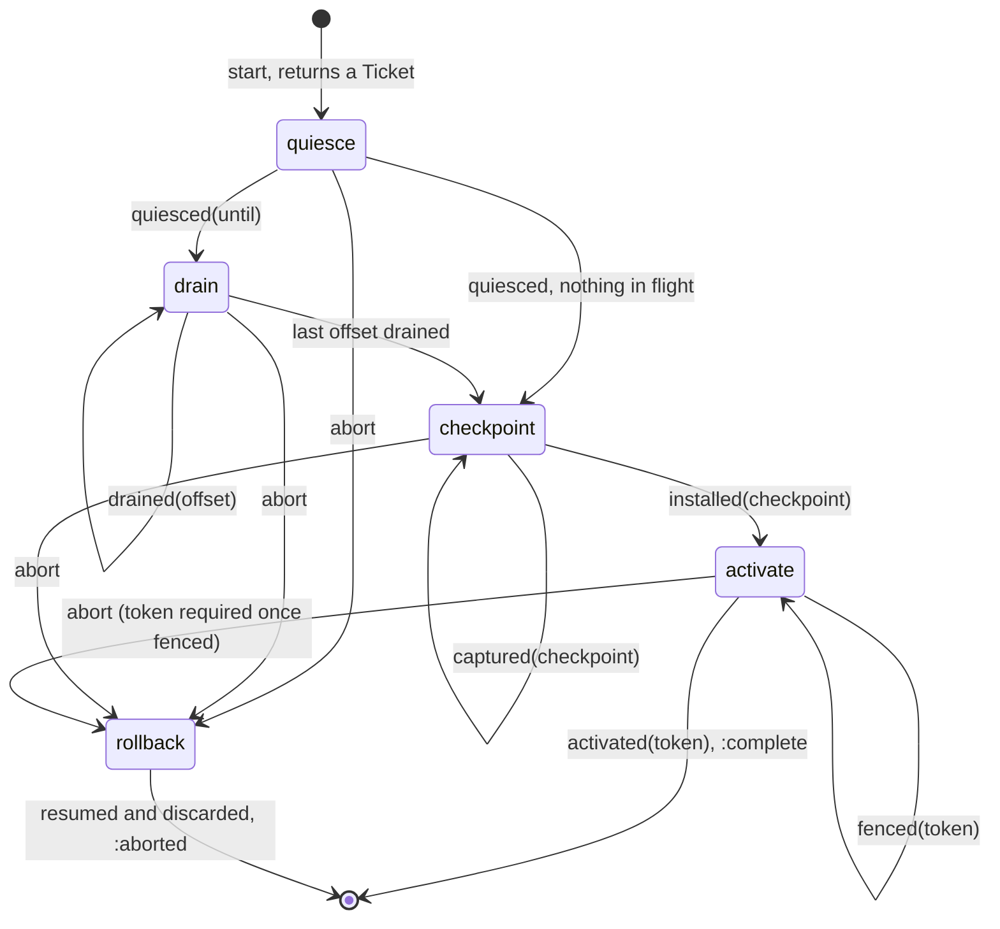
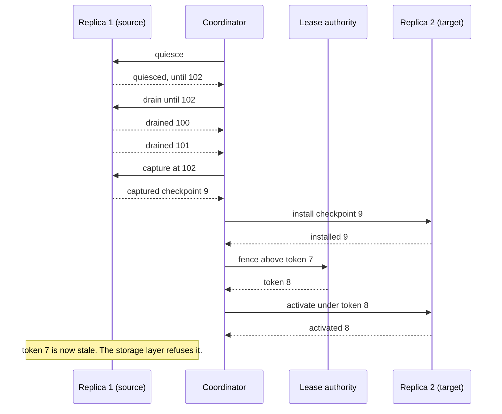

# HandoffMachines

> Two replicas, one partition, and exactly one of them is allowed to be right.

A transfer coordinator for Ruby. When a partition has to move from one replica to another, the coordinator walks the move through four phases: quiesce the source, drain what is in flight, checkpoint, activate the target. It tells you what is owed next and by whom. Each phase ends only when the replica that owes it says so, with a ticket that proves the answer belongs to this move and not to last Tuesday's.

## Quick Start

```bash
gem 'handoff_machines'
```

```ruby
handoff = HandoffMachines::Coordinator.new(phase_budget_ns: 30_000_000_000, per_replica: 2)

ticket = handoff.start(42, source: 1, target: 2, base: 100, token: 7, now_ns: clock.now_ns)
raise "refused: #{ticket}" if ticket.is_a?(Symbol)

orders, = handoff.orders
orders.each { |order| deliver(order) }   # => Order(to: 1, action: :quiesce)

# ...and as the replies come back:
handoff.quiesced(ticket, 1, 102, clock.now_ns)    # => :drain
handoff.drained(ticket, 1, 100, clock.now_ns)     # => :drain
handoff.drained(ticket, 1, 101, clock.now_ns)     # => :checkpoint
handoff.captured(ticket, 1, 9, clock.now_ns)      # => :checkpoint
handoff.installed(ticket, 2, 9, clock.now_ns)     # => :activate
handoff.fenced(ticket, 8, clock.now_ns)           # => :activate
handoff.activated(ticket, 2, 8, clock.now_ns)     # => :complete
```

One coordinator, one method per acknowledgement. Partitions, replicas, offsets, checkpoints and tokens are Integers. Times are nanoseconds from a clock that only goes forward.

This is an initial release with an unstable API. It is a policy core, not a runtime: it sends nothing, stores nothing and issues no tokens.

## A Message to the Resistance

So you added a node and the cluster needs to rebalance. Partition 42 has to move from the old box to the new one. You wrote the obvious thing: tell the new node it owns 42, tell the old node it doesn't, copy the data across. It worked in staging.

In production the "you don't own it" message sat in a queue for four seconds. For those four seconds both nodes took writes for partition 42. The copy had already been cut, so the old node's last few hundred writes went nowhere. Nobody noticed until a customer asked where their order was.

So you added a flag. Then a sleep. Then a "migration_state" column with values like `copying_2` that only one person understands. Then the copy failed halfway and you discovered there was no way back: the old node had stopped taking writes and the new one had half a partition.

Every one of those patches is a piece of the same small protocol. Stop the source. Wait for what it already accepted. Cut the copy at a known point. Switch owners in a way the storage layer can enforce. And at every step, know how to undo it. That protocol is this gem.

## Chapter 1: Stardate 2026.316, the AMS DeCandia

> **AMS DeCandia**, NCC-4234, *DeCandia*-class transfer tender.
> Cargo changes hands at the airlock, one signature at a time.

The tender doesn't carry cargo. It runs the transfer. Two ships dock, and the tender's deck officer holds a clipboard with four lines on it: bay sealed, loaders clear, manifest matched, new crew has the keys. Nobody moves to the next line until the last one is signed, and the officer checks every signature against the transfer number at the top of the page. A signature for an older transfer goes in the bin.

On a bridge somewhere, a cadet volunteers:

```ruby
def move(partition, from, to)
  to.assign(partition)
  from.unassign(partition)
  copy(partition, from, to)
end
```

"That," says the deck officer, "is two captains and no cargo."

## The Flight Plan

Each transfer the coordinator knows about is in one of these phases:



And the afternoon partition 42 moved from replica 1 to replica 2:



The arrows out of the coordinator are orders you deliver. The arrows in are the methods you call.

## How the Coordinator Works

### Start

```ruby
handoff = HandoffMachines::Coordinator.new(phase_budget_ns: 30_000_000_000, per_replica: 2)

ticket = handoff.start(42, source: 1, target: 2, base: 100, token: 7, now_ns: 0)
ticket   # => #<data HandoffMachines::Ticket partition=42, generation=1>
```

`base` is the lowest offset the source has not durably committed. `token` is the fencing token the source serves under today. The `Ticket` carries a generation that is never issued twice. Send it along with every order and have the replica send it back.

### Orders

```ruby
orders, position = handoff.orders
orders.first   # => #<data HandoffMachines::Order ticket=..., to=1, action=:quiesce, value=nil>
```

Orders are not a queue. They are a restatement of what each transfer is waiting for, so asking twice gives the same answer until somebody acknowledges. A transfer owes at most two orders at a time. Take them in chunks if you like:

```ruby
chunk, position = handoff.orders(0, limit: 4)
chunk, position = handoff.orders(position, limit: 4)   # carries on where the last one stopped
```

`to` is a replica id, or `:authority` when the order is for whoever issues your fencing tokens.

### Quiesce

```ruby
handoff.quiesced(ticket, 1, 102, 1)   # => :drain
```

The source stopped admitting new work and reports its quiesce point: one past the last offset it accepted. If that equals `base`, nothing is in flight and the answer is `:checkpoint` directly.

### Drain

```ruby
handoff.drained(ticket, 1, 101, 2)   # => :drain
handoff.outstanding(ticket)          # => [100]
handoff.drained(ticket, 1, 100, 3)   # => :checkpoint
```

Every offset between `base` and the quiesce point must be acknowledged, in any order. The phase ends when there are no holes left. `outstanding` lists the holes; pass a starting offset and a `limit:` to page through a long list.

A drain can track 256 offsets at a time. If more than that is in flight, confirm what the source has durably committed and the window slides forward:

```ruby
handoff.drained(ticket, 1, 100 + 256, 2)   # => :out_of_window
handoff.committed(ticket, 1, 101, 2)       # => :drain, window now starts at 101
```

### Checkpoint

```ruby
handoff.captured(ticket, 1, 9, 4)    # => :checkpoint  (source captured checkpoint 9)
handoff.installed(ticket, 2, 9, 5)   # => :activate    (target installed the same one)
handoff.installed(ticket, 2, 8, 5)   # would have been :mismatch
```

The source captures state at exactly the quiesce point and names it. The target must acknowledge that same name. The coordinator never sees the bytes.

### Activate

```ruby
handoff.orders.first.first           # => Order(to: :authority, action: :fence, value: 7)
handoff.fenced(ticket, 8, 6)         # => :activate
handoff.activated(ticket, 2, 8, 7)   # => :complete
```

First the authority issues the target a token strictly greater than the source's. A token that isn't greater is `:stale_token`. Then the target acknowledges it is serving under that exact token. `:complete` frees the slot.

### Abort

```ruby
handoff.abort(ticket, 5)             # => :rollback
handoff.orders.first.map(&:action)   # => [:resume, :discard]
handoff.resumed(ticket, 1, 6)        # => :rollback
handoff.discarded(ticket, 2, 6)      # => :aborted
```

You can abort from any phase. The source always owes `resumed`, because it may have quiesced. The target owes `discarded` only once it was asked to install something.

After `fenced`, activation has been ordered and the target may already be serving. A plain abort is refused:

```ruby
handoff.abort(ticket, 8)             # => :fence_required
handoff.abort(ticket, 8, token: 9)   # => :rollback, source resumes under token 9
```

The rollback token must beat the activation token, so the target is fenced out the same way the source would have been.

### Stale tickets

```ruby
handoff.quiesced(old_ticket, 1, 102, 9)                         # => :stale
handoff.quiesced(HandoffMachines::Ticket.new(42, 999), 1, 0, 9) # => :unknown
```

A ticket whose transfer has finished, aborted or been replaced is `:stale`. A generation this coordinator never issued is `:unknown`. Neither changes anything.

### Capacity

The coordinator holds 16 transfers at a time, and each replica can take part in at most `per_replica` of them:

```ruby
HandoffMachines::CAPACITY   # => 16
HandoffMachines::WINDOW     # => 256

handoff.start(43, source: 1, target: 2, base: 0, token: 3, now_ns: 0)   # => Ticket
handoff.start(44, source: 1, target: 3, base: 0, token: 3, now_ns: 0)   # => :replica_busy
handoff.start(42, source: 4, target: 5, base: 0, token: 3, now_ns: 0)   # => :busy, 42 is already moving
```

Past sixteen, `start` says `:full` until a transfer completes or finishes rolling back.

### Time only moves forward

```ruby
handoff.quiesced(ticket, 1, 102, 10)   # => :drain
handoff.drained(ticket, 1, 100, 9)     # => :clock_regressed
```

Each phase gets `phase_budget_ns` from the moment it begins. The coordinator will tell you who is over:

```ruby
late, position = handoff.overdue(clock.now_ns)   # => [[Ticket, ...], 16]
```

That's all it does about it. A late acknowledgement is still accepted, and nothing is aborted for you. A source that has been quiesced for too long is your call.

## The Rules of the Tender

- **Everything is an Integer** in `0..2**64-1`. Fencing tokens start at 1. Floats, nil, and strings raise `TypeError`. Out of range raises `RangeError`.
- **Tickets are plain data.** A `Ticket` is a `Data` with a partition and a generation, so it survives a trip over the wire. Anything that isn't a `Ticket` raises `TypeError`.
- **Refusals don't raise.** Every method answers with a phase from `HandoffMachines::PHASES` or a refusal from `HandoffMachines::REFUSALS`. Only malformed input raises.
- **A refusal changes nothing.** Not the phase, not the window, not the clock.
- **Acknowledgements come from the right replica.** `quiesced`, `drained`, `committed`, `captured` and `resumed` from the source; `installed`, `activated` and `discarded` from the target. Anyone else is `:wrong_replica`.
- **Frozen means frozen.** `freeze` the coordinator and every acknowledgement raises `FrozenError`.

## What You Think You're Doing vs Reality

### You Think: "I'll tell the old node to stop, then tell the new node to start."
### Reality: The old node didn't get the message.

A quiesce order is a request. The source that never received it, or received it and then stalled for ten seconds, will keep writing with a clear conscience. The only thing that actually stops it is a storage layer that has seen token 8 and refuses token 7. The coordinator makes sure a token 8 exists before the target is told to serve, and that it is greater than 7. Getting your storage to check it on every write is the part you can't skip.

### You Think: "If it goes wrong, I'll just cancel."
### Reality: Cancel what, exactly?

Before the checkpoint, cancelling means telling the source to carry on. After the target installed something, it also means telling the target to throw it away. After the target was told to activate, it means fencing the target out with a newer token, because it may have taken writes. Each phase has a different undo, and `abort` is the one place that knows which.

## What's Yours

The coordinator lives in your process and forgets everything when the process does. Write `generation` somewhere durable before you hand out a ticket, and build the next coordinator with `last_generation:` so old tickets stay old. Transfers that were in flight are not restored: start them again, and let your lease authority's highest token decide who owns a partition that was mid-activation.

Replica ids are whatever you say they are. The coordinator compares them and cannot tell a restarted replica from an impostor. Fencing tokens must come from one serialized authority, and the resource they protect has to reject older ones atomically with each write. If you abort without a token while the authority might already have granted the target one, report the grant with `fenced` first.

Delivery, retries, checkpoint bytes and retiring the source after `:complete` are yours too. So is choosing which partition moves where. This gem moves ownership. It does not rank placement.

## License

MIT License. See [LICENSE.txt](LICENSE.txt) for details.

**Remember: for four seconds, both nodes thought they owned it. The question is whether your storage agreed.**
