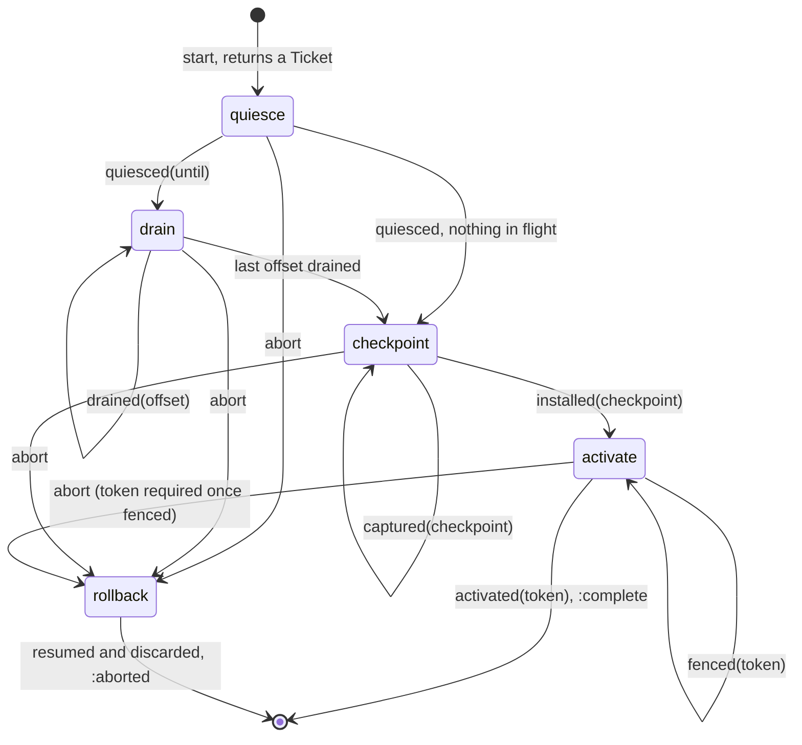
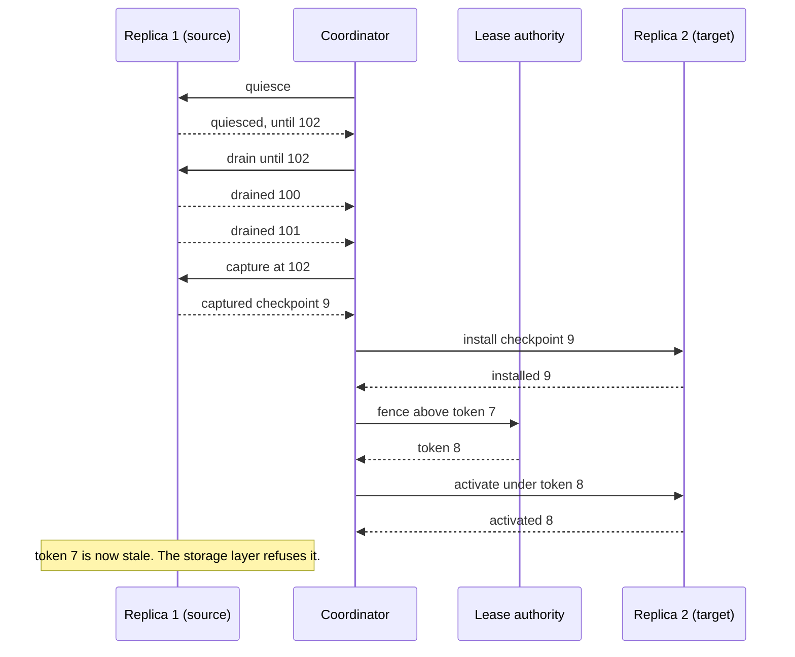

# HandoffMachines

> Two replicas, one partition, and exactly one of them is allowed to be right.

A transfer coordinator for Ruby. When a partition has to move from one replica to another, the coordinator walks the move through four phases: quiesce the source, drain what is in flight, checkpoint, activate the target. It tells you what is owed next and by whom. Each phase ends only when the replica that owes it says so, with a ticket that proves the answer belongs to this move and not to last Tuesday's.

## Quick Start

```bash
gem 'handoff_machines'
```

```ruby
limits = HandoffMachines::Limits.new(30_000_000_000, 2)   # phase_budget, per_replica
handoff = HandoffMachines::Handoff.new(limits)

# Fencing tokens are values your lease authority issues. The source serves under `held`.
held = HandoffMachines::FencingToken.from_raw(7)

# partition, source, target, base, source_token, now
ticket = handoff.start(42, 1, 2, 100, held, clock.now)
raise "refused: #{ticket}" if ticket.is_a?(Symbol)

orders, = handoff.orders(0, 32)
orders.each { |order| deliver(order) }   # => Order(to: Replica(1), action: :quiesce)

# ...and as the replies come back:
handoff.quiesced(ticket, 1, 102, clock.now)    # => Recorded(:drain)
handoff.drained(ticket, 1, 100, clock.now)     # => Recorded(:drain)
handoff.drained(ticket, 1, 101, clock.now)     # => Recorded(:checkpoint)
handoff.captured(ticket, 1, 9, clock.now)      # => Recorded(:checkpoint)
handoff.installed(ticket, 2, 9, clock.now)     # => Recorded(:activate)
granted = HandoffMachines::FencingToken.from_raw(8)   # the authority's answer to the Fence order
handoff.fenced(ticket, granted, clock.now)       # => Recorded(:activate)
handoff.activated(ticket, 2, granted, clock.now) # => Recorded(:complete)
```

One coordinator, one method per acknowledgement. The Ruby API is the core's, name for name: `HandoffMachines::Handoff` is the core's `Handoff`, every `Data` value has the fields of the core struct or enum variant it mirrors, and arguments come in the core's order. Partitions, replicas, offsets and checkpoints are Integers; fencing tokens are `FencingToken` values. Time is Integer nanoseconds on one monotonic clock, `Process.clock_gettime(Process::CLOCK_MONOTONIC, :nanosecond)`, for instants (`now`, `deadline`) and spans (`phase_budget`) alike. No floats, no milliseconds, no `Time.now`.

This is an initial release with an unstable API. It is a policy core, not a runtime: it sends nothing, stores nothing and issues no tokens.

## A Message to the Resistance

So you added a node and the cluster needs to rebalance. Partition 42 has to move from the old box to the new one. You wrote the obvious thing: tell the new node it owns 42, tell the old node it doesn't, copy the data across. It worked in staging.

In production the "you don't own it" message sat in a queue for four seconds. For those four seconds both nodes took writes for partition 42. The copy had already been cut, so the old node's last few hundred writes went nowhere. Nobody noticed until a customer asked where their order was.

So you added a flag. Then a sleep. Then a "migration_state" column with values like `copying_2` that only one person understands. Then the copy failed halfway and you discovered there was no way back: the old node had stopped taking writes and the new one had half a partition.

Every one of those patches is a piece of the same small protocol. Stop the source. Wait for what it already accepted. Cut the copy at a known point. Switch owners in a way the storage layer can enforce. And at every step, know how to undo it. That protocol is this gem.

## Chapter 1: Stardate 2026.316, the AMS DeCandia

> **AMS DeCandia**, NCC-4234, *DeCandia*-class transfer tender.
> Cargo changes hands at the airlock, one signature at a time.

The tender doesn't carry cargo. It runs the transfer. Two ships dock, and the tender's deck officer holds a clipboard with four lines on it: bay sealed, loaders clear, manifest matched, new crew has the keys. Nobody moves to the next line until the last one is signed, and the officer checks every signature against the transfer number at the top of the page. A signature for an older transfer goes in the bin.

On a bridge somewhere, a cadet volunteers:

```ruby
def move(partition, from, to)
  to.assign(partition)
  from.unassign(partition)
  copy(partition, from, to)
end
```

"That," says the deck officer, "is two captains and no cargo."

## The Flight Plan

Each transfer the coordinator knows about is in one of these phases:



And the afternoon partition 42 moved from replica 1 to replica 2:



The arrows out of the coordinator are orders you deliver. The arrows in are the methods you call.

## How the Coordinator Works

### Start

```ruby
limits = HandoffMachines::Limits.new(30_000_000_000, 2)
handoff = HandoffMachines::Handoff.new(limits)
handoff.limits   # => #<data HandoffMachines::Limits phase_budget=30000000000, per_replica=2>

held = HandoffMachines::FencingToken.from_raw(7)
ticket = handoff.start(42, 1, 2, 100, held, 0)
ticket   # => #<data HandoffMachines::Ticket partition=42, generation=1>
```

`Limits` is `phase_budget` (how long one phase may last before `overdue` reports it) and `per_replica` (how many transfers one replica may take part in). `start(partition, source, target, base, source_token, now)` takes the core's arguments in the core's order: `base` is the lowest offset the source has not durably committed, and `source_token` is the fencing token the source serves under today; its scope is the transfer's token scope. The `Ticket` carries a generation that is never issued twice. Send it along with every order and have the replica send it back.

### Orders

```ruby
orders, position = handoff.orders(0, 32)
orders.first   # => #<data HandoffMachines::Order ticket=..., to=#<data HandoffMachines::Replica id=1>, action=:quiesce>
```

Orders are not a queue. They are a restatement of what each transfer is waiting for, so asking twice gives the same answer until somebody acknowledges. A transfer owes at most two orders at a time. Take them in chunks if you like:

```ruby
chunk, position = handoff.orders(0, 4)
chunk, position = handoff.orders(position, 4)   # carries on where the last one stopped
```

`orders(from, limit)` answers at most `limit` orders from position `from` (zero to begin) and the position to resume at.

`to` is a `Replica(id)`, or `:authority` when the order is for whoever issues your fencing tokens. `action` says what they must do, one value per core `Action` variant:

| `action` | For | Meaning |
| --- | --- | --- |
| `:quiesce` | source | stop admitting new work and report the quiesce point |
| `Drain(until)` | source | finish in-flight offsets below `until` and acknowledge each |
| `Capture(at)` | source | capture a checkpoint at exactly `at` and report its identity |
| `Install(checkpoint)` | target | install the named checkpoint |
| `Fence(above)` | authority | issue the target a token strictly greater than `above` |
| `Activate(token)` | target | start serving under `token` |
| `Resume(token)` | source | resume serving, under `token` when the rollback was fenced (else `nil`) |
| `:discard` | target | stop serving if it started, and drop the installed checkpoint |

### Quiesce

```ruby
handoff.quiesced(ticket, 1, 102, 1)   # => #<data HandoffMachines::Recorded phase=:drain>
```

The source stopped admitting new work and reports its quiesce point: one past the last offset it accepted. If that equals `base`, nothing is in flight and the answer is `Recorded(:checkpoint)` directly.

Every acknowledgement answers the core's `Acked`: `Recorded(phase)` the first time, `Duplicate(phase)` for a repeat, where `phase` is where the transfer stands after the call. Both answer `duplicate?`. A refusal is a Symbol instead.

### Drain

```ruby
handoff.drained(ticket, 1, 101, 2)        # => Recorded(:drain)
handoff.outstanding(ticket, 0, 256)       # => [100]
handoff.drained(ticket, 1, 100, 3)        # => Recorded(:checkpoint)
```

Every offset between `base` and the quiesce point must be acknowledged, in any order. The phase ends when there are no holes left. `outstanding(ticket, from, limit)` lists at most `limit` holes, ascending from offset `from`; ask again from the last one plus one to page through a long list.

Replies get delivered twice. That is not an error:

```ruby
handoff.drained(ticket, 1, 101, 2)   # => Recorded(:drain)
handoff.drained(ticket, 1, 101, 2)   # => Duplicate(:drain), it was already acknowledged
```

`Duplicate` is not a refusal. The offset is acknowledged, which is what the source was telling you. It was just true before it said so again. Nothing changes: not the phase, not the window, not the clock.

Every acknowledgement works this way, not just `drained`. The coordinator answers a repeat from what the transfer recorded, for as long as the transfer lives, and `Duplicate#phase` is where the transfer stands now:

```ruby
handoff.quiesced(ticket, 1, 102, 1)   # => Recorded(:drain)
handoff.quiesced(ticket, 1, 102, 9)   # => Duplicate(:activate), three phases later
handoff.quiesced(ticket, 1, 105, 9)   # => :mismatch, that is not what was recorded
```

Same story, different payload, is not a repeat. A quiesce point, checkpoint or token that differs from the recorded one is `:mismatch`. And `:out_of_phase` means only this: the transfer is not waiting for that acknowledgement and never recorded it. It came too early, or the transfer was aborted before it arrived.

A drain can track 256 offsets at a time. If more than that is in flight, confirm what the source has durably committed and the window slides forward:

```ruby
handoff.drained(ticket, 1, 100 + 256, 2)   # => :out_of_window
handoff.committed(ticket, 1, 101, 2)       # => Recorded(:drain), window now starts at 101
handoff.committed(ticket, 1, 101, 2)       # => Duplicate(:drain), already committed
```

### Checkpoint

```ruby
handoff.captured(ticket, 1, 9, 4)    # => Recorded(:checkpoint)  (source captured checkpoint 9)
handoff.installed(ticket, 2, 9, 5)   # => Recorded(:activate)    (target installed the same one)
handoff.installed(ticket, 2, 8, 5)   # would have been :mismatch
```

The source captures state at exactly the quiesce point and names it. The target must acknowledge that same name. The coordinator never sees the bytes.

### Activate

```ruby
handoff.orders(0, 32).first.first          # => Order(to: :authority, action: Fence(above: FencingToken(raw: 7)))
granted = HandoffMachines::FencingToken.from_raw(8)
handoff.fenced(ticket, granted, 6)         # => Recorded(:activate)
handoff.activated(ticket, 2, granted, 7)   # => Recorded(:complete)
```

First the authority issues the target a token strictly newer than the source's. A token of the source token's scope that isn't newer is `:stale_token`. Then the target acknowledges it is serving under that exact token. `Recorded(:complete)` frees the slot.

### Fencing tokens

A `FencingToken` is the lease core's token, which the handoff core re-exports: plain data whose `raw` is the issuing authority's scope in the top 16 bits above a sequence number counted from 1. The coordinator issues none. Every method that takes a token (`start`, `fenced`, `activated`, `abort`) reads its `raw`, so a `LeaseMachines::FencingToken` fits as it is: pass `lease.token`, not `lease.token.raw`. This gem does not depend on that one. A bare Integer is not a token and raises `TypeError`; rebuild one that crossed a wire with `HandoffMachines::FencingToken.from_raw(raw)`. Tokens come back as `HandoffMachines::FencingToken` in `Fence#above`, `Activate#token`, `Resume#token` and `Status#token`.

Tokens of one scope are ordered. Tokens of two scopes are not: there is no `<`, `order` answers `nil` and `newer_than?` answers `false`. So a transfer reads tokens only inside its source token's scope, and a token of any other scope is `:unknown`, whatever its number, from every call that takes one: `fenced`, `activated` and `abort`. That is the fleet's name for an id that is not of the namespace the call reads it in. It is answered before the transfer's phase or its recorded token is looked at, so it is never folded into "older" (`:stale_token`), "not the one recorded" (`:mismatch`) or "not now" (`:out_of_phase`). While the transfer still waits for the authority's token:

```ruby
other = HandoffMachines::FencingToken.from_raw((3 << 48) | 8)   # scope 3, the source token is scope 0
handoff.fenced(ticket, other, 6)   # => :unknown, nothing changed
handoff.fenced(ticket, held, 6)    # => :stale_token, right scope, not newer
```

One transfer therefore lives under one authority scope. If your authority came back under a new scope before `fenced`, give the transfer up with `abort(ticket, nil, now)` and start it again under a source token of the new scope.

### Abort

```ruby
handoff.abort(ticket, nil, 5)               # => Recorded(:rollback)
handoff.orders(0, 32).first.map(&:action)   # => [Resume(token: nil), :discard]
handoff.resumed(ticket, 1, 6)               # => Recorded(:rollback)
handoff.discarded(ticket, 2, 6)             # => Recorded(:aborted)
```

`abort(ticket, token, now)` takes the rollback token in the core's position; pass `nil` for an unfenced abort.

You can abort from any phase. The source always owes `resumed`, because it may have quiesced. The target owes `discarded` only once it was asked to install something.

A `resumed` or `discarded` the rollback is not waiting for, because it already arrived or because the target was never asked to install anything, answers `Duplicate(:rollback)` while the rollback is still open. So does a second `abort` with the same token (or the same `nil`); with a different one it is `:mismatch`. Replies the transfer recorded before the abort still answer `Duplicate(:rollback)` too. Once the rollback ends as `Recorded(:aborted)` the ticket is `:stale`.

After `fenced`, activation has been ordered and the target may already be serving. A plain abort is refused:

```ruby
handoff.abort(ticket, nil, 8)   # => :fence_required
newer = HandoffMachines::FencingToken.from_raw(9)
handoff.abort(ticket, newer, 8)   # => Recorded(:rollback), source resumes under token 9
```

The rollback token must be of the same scope and beat the activation token, so the target is fenced out the same way the source would have been. One of another scope is `:unknown`, whatever else is wrong with the call; one of the right scope that doesn't beat it is `:stale_token`.

### Stale tickets

```ruby
handoff.quiesced(old_ticket, 1, 102, 9)                         # => :stale
handoff.quiesced(HandoffMachines::Ticket.new(42, 999), 1, 0, 9) # => :unknown
```

A ticket whose transfer has finished, aborted or been replaced is `:stale`. A generation this coordinator never issued is `:unknown`, and that includes every ticket from a coordinator of another scope. Neither changes anything.

### Capacity

The coordinator holds 16 transfers at a time, and each replica can take part in at most `per_replica` of them:

```ruby
HandoffMachines::CAPACITY   # => 16
HandoffMachines::WINDOW     # => 256

handoff.start(43, 1, 2, 0, 3, 0)   # => Ticket
handoff.start(44, 1, 3, 0, 3, 0)   # => :replica_busy
handoff.start(42, 4, 5, 0, 3, 0)   # => :busy, 42 is already moving
```

Past sixteen, `start` says `:full` until a transfer completes or finishes rolling back.

### Time only moves forward

```ruby
handoff.quiesced(ticket, 1, 102, 10)   # => Recorded(:drain)
handoff.drained(ticket, 1, 100, 9)     # => :clock_regressed
```

Each phase gets `Limits#phase_budget` from the moment it begins. The coordinator will tell you who is over:

```ruby
late, position = handoff.overdue(clock.now, 0, 16)   # => [[Ticket, ...], 16]
```

`overdue(now, from, limit)` answers at most `limit` tickets from slot `from` (zero to begin) and the slot to resume at.

That's all it does about it. A late acknowledgement is still accepted, and nothing is aborted for you. A source that has been quiesced for too long is your call.

### Every answer

A call that is honoured answers with a value. A call that is not honoured answers with one of the refusal symbols below, and only those, and changes nothing. Each refusal is the snake_case of one core `Refusal` variant; there is no catch-all symbol. `Duplicate(phase)` is an honoured repeat: the transfer already recorded that acknowledgement with that payload, and nothing changed.

Every acknowledgement can also refuse with `:clock_regressed`, `:stale` or `:unknown` (the *ticket refusals*). From `fenced`, `activated` and `abort`, `:unknown` can also be a fencing token of another scope than the transfer's source token. Refusals are listed in the order they are checked, and the first that applies is the answer: the ticket refusals first (`:clock_regressed`, then `:unknown` or `:stale` for the ticket), then the rest left to right. `:out_of_phase` always means "not awaited and never recorded": too early, or the transfer was given up first. `:mismatch` means the payload is not the recorded one. `activated`, and the `resumed` or `discarded` that ends a rollback, free the slot: their repeats are `:stale`.

| Call | Honoured | Refusals |
| --- | --- | --- |
| `start(partition, source, target, base, source_token, now)` | `Ticket` | `:clock_regressed`, `:same_replica`, `:busy`, `:full`, `:replica_busy`, `:exhausted` |
| `quiesced(ticket, replica, until_offset, now)` | `Recorded(:drain)`, `Recorded(:checkpoint)`, `Duplicate` (same `until_offset` again) | ticket refusals, `:out_of_phase`, `:wrong_replica`, `:behind_base`, `:mismatch` (different `until_offset`) |
| `drained(ticket, replica, offset, now)` | `Recorded(:drain)`, `Recorded(:checkpoint)`, `Duplicate` (offset already acknowledged or committed) | ticket refusals, `:out_of_phase`, `:wrong_replica`, `:beyond_drain`, `:out_of_window` |
| `committed(ticket, replica, offset, now)` | `Recorded(:drain)`, `Duplicate` (offset already committed) | ticket refusals, `:out_of_phase`, `:wrong_replica`, `:unacked` |
| `captured(ticket, replica, checkpoint, now)` | `Recorded(:checkpoint)`, `Duplicate` (same checkpoint again) | ticket refusals, `:out_of_phase`, `:wrong_replica`, `:mismatch` (different checkpoint) |
| `installed(ticket, replica, checkpoint, now)` | `Recorded(:activate)`, `Duplicate` (same checkpoint again) | ticket refusals, `:out_of_phase`, `:wrong_replica`, `:mismatch` (not the captured checkpoint) |
| `fenced(ticket, token, now)` | `Recorded(:activate)`, `Duplicate` (same token again) | ticket refusals, `:unknown` (token of another scope), `:mismatch` (a different token is recorded), `:out_of_phase`, `:stale_token` (not newer than the source token) |
| `activated(ticket, replica, token, now)` | `Recorded(:complete)` | ticket refusals, `:unknown` (token of another scope), `:out_of_phase`, `:wrong_replica`, `:mismatch` (not the fenced token) |
| `abort(ticket, token, now)` | `Recorded(:rollback)`, `Duplicate` (rollback under way, same `token`) | ticket refusals, `:unknown` (token of another scope), `:mismatch` (rollback under way, different `token`), `:stale_token` (not newer than every token known), `:fence_required` |
| `resumed(ticket, replica, now)` | `Recorded(:rollback)`, `Recorded(:aborted)`, `Duplicate` (already recorded) | ticket refusals, `:out_of_phase`, `:wrong_replica` |
| `discarded(ticket, replica, now)` | `Recorded(:rollback)`, `Recorded(:aborted)`, `Duplicate` (already recorded or never owed) | ticket refusals, `:out_of_phase`, `:wrong_replica` |
| `outstanding(ticket, from, limit)` | `Array` of offsets | `:stale`, `:unknown`, `:out_of_phase` |

A `Duplicate` carries the phase the transfer stands at now: any phase from the one the acknowledgement first led to up to `:rollback`.

`Handoff.new(limits)`, `Handoff.with_scope(limits, scope)`, `limits`, `scope`, `status`, `orders`, `overdue`, `active` and `generation` never refuse. `Handoff.restored(limits, scope, last_generation)` answers a coordinator or raises `RangeError` when `last_generation` is not a generation of `scope`.

## The Rules of the Tender

- **Ids are Integers** in `0..2**64-1`: partitions, replicas, offsets, checkpoints. Floats, nil, and strings raise `TypeError`. Out of range raises `RangeError`.
- **Fencing tokens are values.** Anything with a `raw` reader is a token, the `lease_machines` gem's included; a bare Integer raises `TypeError`, and a `raw` whose sequence number is zero raises `RangeError`.
- **Time is Integer nanoseconds.** `now`, `Limits#phase_budget` and `Status#deadline` are nanoseconds on one monotonic clock. A Float or any other non-Integer raises `TypeError`; a negative value or one past `2**64-1` raises `RangeError`. `deadline` is `now + phase_budget` exactly, so it can read back larger than `2**64-1`.
- **Values mirror the core.** `Limits`, `Ticket`, `Order` and `Status` have the core struct's fields in the core's order. An enum variant with a field is a `Data` named after it (`Recorded`, `Duplicate`, `Replica`, `Drain`, `Capture`, `Install`, `Fence`, `Activate`, `Resume`); one without is a Symbol (`:authority`, `:quiesce`, `:discard`, every phase). No argument has a default the core lacks: `orders`, `outstanding` and `overdue` take `from` and `limit` every time, and `limit` is the one argument the core does not have, because Ruby gets an Array where the core hands out an iterator.
- **Tickets are plain data.** A `Ticket` is a `Data` with a partition and a generation, so it survives a trip over the wire. Anything that isn't a `Ticket` raises `TypeError`, and so does a constructor given anything but a `Limits`.
- **Scopes.** A ticket is only meaningful to the coordinator that issued it. Generations count from 1, so two coordinators hand out the same tickets for the same partition, and a reply sent to the wrong one would be recorded there. Give each coordinator its own scope: `Handoff.with_scope(limits, scope)`, any Integer in `0..65_535` (a non-Integer raises `TypeError`, anything outside the range raises `RangeError`). `Handoff.new(limits)` is scope zero. The scope rides in the top 16 bits of every generation; `handoff.scope` and `ticket.scope` read it back. A ticket from another scope is `:unknown` to every acknowledgement and to `outstanding`, and changes nothing. The coordinator can't pick a scope for you, and two coordinators left in the same scope still mix up each other's tickets.
- **Refusals don't raise.** Every acknowledgement answers with a `Recorded` or `Duplicate` whose phase is one of `HandoffMachines::PHASES`, or with a refusal from `HandoffMachines::REFUSALS`. Only malformed input raises.
- **A refusal changes nothing.** Not the phase, not the window, not the clock.
- **A repeat is not a refusal.** Every acknowledgement answers `Duplicate` when the transfer already recorded it with the same payload. Treat it as success. It changes nothing either. Only `activated` never does: it frees the slot, so its repeat is `:stale`.
- **Acknowledgements come from the right replica.** `quiesced`, `drained`, `committed`, `captured` and `resumed` from the source; `installed`, `activated` and `discarded` from the target. Anyone else is `:wrong_replica`.
- **Frozen means frozen.** `freeze` the coordinator and `start` and every acknowledgement raise `FrozenError`. Reads still work.

## What You Think You're Doing vs Reality

### You Think: "I'll tell the old node to stop, then tell the new node to start."
### Reality: The old node didn't get the message.

A quiesce order is a request. The source that never received it, or received it and then stalled for ten seconds, will keep writing with a clear conscience. The only thing that actually stops it is a storage layer that has seen token 8 and refuses token 7. The coordinator makes sure a token 8 exists before the target is told to serve, and that it is greater than 7. Getting your storage to check it on every write is the part you can't skip.

### You Think: "If it goes wrong, I'll just cancel."
### Reality: Cancel what, exactly?

Before the checkpoint, cancelling means telling the source to carry on. After the target installed something, it also means telling the target to throw it away. After the target was told to activate, it means fencing the target out with a newer token, because it may have taken writes. Each phase has a different undo, and `abort` is the one place that knows which.

## What's Yours

The coordinator lives in your process and forgets everything when the process does. A fresh coordinator counts from 1 again, so a ticket that outlived a restart could name a new transfer. Either resume the sequence or give each incarnation a scope no earlier one used. To resume, write `generation` somewhere durable before you hand out a ticket, and build the next coordinator with `Handoff.restored(limits, scope, last_generation)` so old tickets stay old. The scope is yours to pass, never read out of the saved value: a value from another scope, one that lost its top bits, or a bare `0` for a non-zero scope raises `RangeError`. A coordinator that issued nothing answers `scope << 48`, and that is the only spelling of "nothing issued yet"; with no saved row at all, call `Handoff.with_scope`. Transfers that were in flight are not restored: start them again, and let your lease authority's highest token decide who owns a partition that was mid-activation.

Replica ids are whatever you say they are. The coordinator compares them and cannot tell a restarted replica from an impostor. Fencing tokens must come from one serialized authority, and the resource they protect has to reject older ones atomically with each write. If you abort without a token while the authority might already have granted the target one, report the grant with `fenced` first.

Delivery, retries, checkpoint bytes and retiring the source after `Recorded(:complete)` are yours too. So is choosing which partition moves where. This gem moves ownership. It does not rank placement.

## License

MIT License. See [LICENSE.txt](LICENSE.txt) for details.

**Remember: for four seconds, both nodes thought they owned it. The question is whether your storage agreed.**
